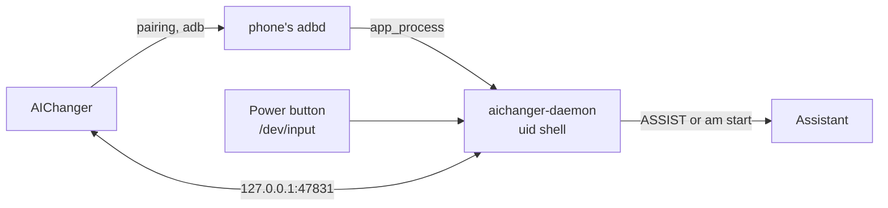

<div align="center">


# AIChanger

**Hold the power button on vivo to open Gemini, Claude, ChatGPT, Perplexity or Alice instead of BlueLM**

[](https://github.com/DQuest/AIChanger/actions/workflows/build.yml)


[](LICENSE)

[Русский](README.md) · **English**

[**Download APK**](https://github.com/DQuest/AIChanger/releases/latest) · [Changelog](#changelog)

</div>

---

On vivo phones with OriginOS 6, holding the power button always brings up BlueLM: the firmware ignores the standard
Android setting. AIChanger gives the button back to the AI assistant of your choice. All it takes is one app:
no root, no Shizuku, no computer.

## Contents

- [Features](#features)
- [Assistants](#assistants)
- [Requirements](#requirements)
- [Installation](#installation)
- [Setup](#setup)
- [Usage](#usage)
- [Autostart and limitations](#autostart-and-limitations)
- [Turning off and uninstalling](#turning-off-and-uninstalling)
- [How it works](#how-it-works)
- [For developers](#for-developers)
- [Changelog](#changelog)
- [License](#license)

## Features

- 🎙️ **Assistant on power-button hold** — Gemini, Claude, ChatGPT, Perplexity or Alice, chosen in the app.
- ⏻ **Power menu still there** — hold the button for about 2 seconds to get the usual vivo menu.
- 📸 **Key combos keep working** — power with volume (screenshot and others) behaves as before.
- 🔒 **Lock screen aware** — asks you to unlock first, then opens the assistant.
- 🔁 **Autostart** — after a reboot or an update everything starts by itself, even before the first unlock.
- 🧹 **Clean rollback** — turning AIChanger off or uninstalling it restores the previous system assistant.

## Assistants

Only apps with their own voice assistant service are listed: they open on top of the current screen.
Apps without one (DeepSeek, for example) are not shown.

| Assistant | How it is invoked | Changes the phone's assistant |
|---|---|---|
| **Gemini** | Assistant key. "Listen right away" mode (default, as on Samsung) or a window without listening | Only if the phone's assistant is not Google |
| **Claude**, **Perplexity**, **Alice** | Their assistant mode is launched directly and starts listening | No |
| **ChatGPT** | Works only as the phone's assistant | Yes; the previous one returns when you pick another or turn AIChanger off |

## Requirements

- A vivo phone with **OriginOS 6** (Android 16). Tested on vivo X200 Ultra.
- **Wi-Fi** where wireless debugging is allowed ("Always allow on this network"): the app uses it to start its service.
- No root, Shizuku or computer needed.
- The app speaks English or Russian, following the phone's language. You can also pick it separately in the Android
  settings, under app languages.

## Installation

### Prebuilt APK

Download `AIChanger-v<version>.apk` from the [latest release](https://github.com/DQuest/AIChanger/releases/latest)
and install it on the phone.

### Build it yourself

```bash
./gradlew :app:assembleRelease
adb install -r app/build/outputs/apk/release/app-release.apk
```

The release build is signed with your debug key (`~/.android/debug.keystore`), just like a debug build.

> [!NOTE]
> vivo asks to confirm an adb install on the screen, so keep the phone unlocked.

## Setup

The in-app wizard walks you through these steps; they are listed here for reference. You only do this once.

1. **Turn off BlueLM** on power-button hold in the phone settings. AIChanger does not do it for you; otherwise both
   assistants would open.
2. **Enable Developer options**: tap the software version 7 times in "About phone".
3. In AIChanger tap **Open debugging settings**. Developer options open, and an AIChanger notification with a code field appears.
4. Turn on **Wireless debugging**, check **Always allow on this network**, choose **Pair device with pairing code**
   and enter the code in the AIChanger notification. If the app asks for a port, enter "port code" separated by
   a space, or paste the whole "IP address & port" line.
5. **Allow autostart**: find AIChanger in the vivo list and turn the switch on. Without it vivo won't let the app
   start after a reboot.
6. **Allow background activity**: in background power management choose "Allow high power consumption" for
   AIChanger. Otherwise vivo puts the app to sleep while it waits for Wi-Fi after a reboot.

Done. You can switch the assistant in the "Assistant" section of the main screen. Wireless debugging and even
Developer options can be turned off afterwards: the app turns them on for a couple of seconds at startup and
restores them.

> [!NOTE]
> Android forgets a wireless debugging pairing that hasn't been used for a week. To keep it from expiring while the
> phone runs for a long time without a reboot, AIChanger turns on "Disable adb authorization timeout" itself.

## Usage

| Action | What happens |
|---|---|
| Hold power ~0.6 s | The chosen assistant opens |
| Hold power ~2 s | The assistant closes and the power menu opens |
| Power + volume | The usual combo (screenshot etc.), no assistant |
| Hold on the lock screen | Asks you to unlock first, then opens the assistant |

## Autostart and limitations

- After a reboot (even before the first unlock) and after an update, the app waits for Wi-Fi and starts its
  service. It is usually ready a few seconds after boot.
- **Without Wi-Fi** the app waits for it with a notification and starts as soon as a network connects.
- **On another network** where debugging isn't allowed, the app notices within seconds and waits for the right one.
- If autostart didn't work, just open AIChanger: it restarts everything itself.
- If the pairing stops working anyway, the app opens the pairing step of the wizard by itself.

> [!IMPORTANT]
> While the service isn't running, holding the button opens neither an assistant nor BlueLM (you turned it off).

## Turning off and uninstalling

- **Turn off AIChanger** in the app stops the service and restores the previous system assistant if it was changed.
  If the service is already gone, the app restores the assistant over wireless debugging; if that fails (no Wi-Fi,
  for example), the main screen says so and the app retries the next time it opens.
- **Uninstalling** the app: within about half a minute the service restores the previous assistant and exits.
  If the service wasn't running at that moment, turn AIChanger off first and then uninstall.
- **BlueLM** on the power button: turn it back on in the phone settings if you want it.

<details>
<summary>Manual rollback over adb</summary>

```bash
# Put BlueLM back on the power button
adb shell content insert --uri content://settings/system --bind name:s:vivo_jovi_power_wakeup_switch --bind value:s:1
# Make Google the phone's assistant
adb shell cmd role add-role-holder android.app.role.ASSISTANT com.google.android.googlequicksearchbox 0
```

On OriginOS `settings put` silently does nothing for these keys; write them with `content insert`.
The original values are saved in [`backup.txt`](backup.txt).

</details>

## How it works

vivo handles the power-button hold before the system does, and the firmware ignores the standard Android setting
`global power_button_long_press`. So a layer with uid shell rights is needed.



- **The app** pairs with wireless debugging by itself (like Shizuku), connects to its own adbd and starts the daemon
  `app_process … PowerKeyDaemon` (process `aichanger-daemon`). Debugging is then turned off while the daemon keeps
  running.
- **The daemon** ([`PowerKeyEngine`](app/src/main/java/dev/dquest/aichanger/daemon/PowerKeyEngine.kt)) reads power and
  volume key events from `/dev/input`, invokes the assistant on hold (with the assistant key or by launching its
  activity directly) and opens the power menu after ~2 s. The key device is found by name, or by `KEY_POWER` if the
  name is unknown: the `/dev/input/eventN` number changes between boots.
- **The app talks to the daemon** over TCP on `127.0.0.1:47831` with a token that is new for every daemon start
  ([`DaemonProtocol`](app/src/main/java/dev/dquest/aichanger/daemon/DaemonProtocol.kt)). The daemon validates
  everything it receives and passes it to commands only as separate arguments.
- **The wireless debugging port** is found by scanning local ports: mDNS on the phone is unreliable.
- **Uninstall**: the daemon runs as uid shell and survives the app's removal, so it watches for it itself,
  restores the previous assistant and exits.

## For developers

<details>
<summary>GitHub builds and signing</summary>

Every push and pull request builds a release APK and runs the unit tests ([workflow](.github/workflows/build.yml)).
The APK is under **Actions** → the run → **Artifacts** (`AIChanger-<version>-<run number>`, kept for 30 days).

The release APK is signed with the debug key, so it installs over earlier debug builds without uninstalling.
Android installs an update only with the same signature. To install APKs from GitHub over builds from your computer
(and vice versa), add your debug key to the repository secrets: **Settings** → **Secrets and variables** →
**Actions** → **New repository secret**, name `CHANGERKEY`, value:

```bash
base64 -i ~/.android/debug.keystore | pbcopy   # macOS: copies the value to the clipboard
```

Without the secret the APK is signed with a random key: it won't install over an existing app, so you would have to
uninstall it and pair again.

</details>

<details>
<summary>Publishing a release</summary>

1. Bump `versionCode` and `versionName` in [`app/build.gradle.kts`](app/build.gradle.kts).
2. Describe the changes in `release-notes/v<version>.md` — Russian first, then English.
3. Run the workflow manually on `main` (**Actions** → "Сборка APK" → **Run workflow**) or push a `v<version>` tag.
   The workflow builds the APK and creates the release with those notes.

</details>

<details>
<summary>Tests, debugging, layout</summary>

```bash
./gradlew :app:testDebugUnitTest                      # unit tests
adb shell pidof aichanger-daemon                      # is the daemon alive?
adb logcat -s AIChanger                               # app and daemon logs
```

- [`app/src/main/java/dev/dquest/aichanger`](app/src/main/java/dev/dquest/aichanger) — the app (Jetpack Compose UI,
  pairing, daemon launch).
- [`…/daemon`](app/src/main/java/dev/dquest/aichanger/daemon) — the uid shell daemon.
- [`release-notes`](release-notes) — release notes.
- [`prototype/power_to_gemini.py`](prototype/power_to_gemini.py) — the first prototype of the logic, runs from a Mac over adb.
- [`CLAUDE.md`](CLAUDE.md) — detailed notes on the architecture and OriginOS quirks (in Russian).

</details>

## Changelog

All versions and APKs are on the [Releases](https://github.com/DQuest/AIChanger/releases) page; the notes are in
[`release-notes`](release-notes) (Russian and English).

| Version | Highlights |
|---|---|
| [3.12](release-notes/v3.12.md#english) | Gemini that stopped opening from the button recovers by itself, without turning AIChanger off |
| [3.11](release-notes/v3.11.md#english) | Release build: an 8× smaller APK and a faster UI |
| [3.10](release-notes/v3.10.md#english) | The app is now in English: the language follows the phone or the Android settings |
| [3.9](release-notes/v3.9.md#english) | The pairing no longer expires after a week; if it is lost, the app asks to pair again right away |
| [3.8](release-notes/v3.8.md#english) | First GitHub release: BlueLM is no longer touched, a more reliable service and shutdown, quick fallback on untrusted Wi-Fi |

## License

AIChanger is licensed under the [GNU GPL v3.0](LICENSE). You are free to use, study, modify and share the code,
but modified versions you distribute must also be open source under the same license.
