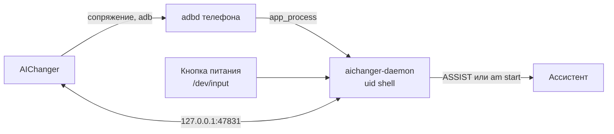

<div align="center">


# AIChanger

**Удержание кнопки питания на vivo открывает Gemini, Claude, ChatGPT, Perplexity или Алису вместо BlueLM**

[](https://github.com/DQuest/AIChanger/actions/workflows/build.yml)


[](LICENSE)

**Русский** · [English](README.en.md)

[**Скачать APK**](https://github.com/DQuest/AIChanger/releases/latest) · [История изменений](#история-изменений)

</div>

---

На телефонах vivo с OriginOS 6 удержание кнопки питания всегда вызывает BlueLM: стандартную настройку Android
прошивка игнорирует. AIChanger возвращает кнопке выбранного вами ИИ-ассистента. Нужно только одно приложение:
без root, Shizuku и компьютера.

## Содержание

- [Возможности](#возможности)
- [Ассистенты](#ассистенты)
- [Требования](#требования)
- [Установка](#установка)
- [Настройка](#настройка)
- [Как пользоваться](#как-пользоваться)
- [Автозапуск и ограничения](#автозапуск-и-ограничения)
- [Выключение и удаление](#выключение-и-удаление)
- [Как это устроено](#как-это-устроено)
- [Для разработчиков](#для-разработчиков)
- [История изменений](#история-изменений)
- [Лицензия](#лицензия)

## Возможности

- 🎙️ **Ассистент по удержанию питания** — Gemini, Claude, ChatGPT, Perplexity или Алиса, выбор в приложении.
- ⏻ **Меню питания на месте** — если держать кнопку около 2 секунд, открывается обычное меню vivo.
- 📸 **Сочетания не ломаются** — питание вместе с громкостью (скриншот и другие) работает как раньше.
- 🔒 **Экран блокировки** — сначала попросит разблокировать телефон, затем откроет ассистента.
- 🔁 **Автозапуск** — после перезагрузки и обновления всё запускается само, ещё до первой разблокировки.
- 🧹 **Аккуратный откат** — при выключении или удалении возвращается прежний системный ассистент.

## Ассистенты

В списке только приложения со своей службой голосового ассистента: они открываются поверх экрана.
Приложения без неё (например, DeepSeek) не показываются.

| Ассистент | Как вызывается | Меняет ассистента телефона |
|---|---|---|
| **Gemini** | Клавиша ассистента. Режим «Сразу слушать» (по умолчанию, как на Samsung) или окно без прослушивания | Только если ассистент телефона — не Google |
| **Claude**, **Perplexity**, **Алиса** | Прямой запуск их режима ассистента, слушают сразу | Нет |
| **ChatGPT** | Работает только как ассистент телефона | Да; прежний вернётся при выборе другого или выключении AIChanger |

## Требования

- Телефон vivo с **OriginOS 6** (Android 16). Проверено на vivo X200 Ultra.
- **Wi-Fi**, в котором разрешена беспроводная отладка («Всегда разрешать в этой сети»): через неё приложение
  запускает свою службу.
- Root, Shizuku и компьютер не нужны.

## Установка

### Готовый APK

Скачайте `AIChanger-v<версия>.apk` со страницы [последнего релиза](https://github.com/DQuest/AIChanger/releases/latest)
и установите его на телефоне.

### Сборка самостоятельно

```bash
./gradlew :app:assembleDebug
adb install -r app/build/outputs/apk/debug/app-debug.apk
```

> [!NOTE]
> vivo просит подтвердить установку по adb на экране, поэтому телефон должен быть разблокирован.

## Настройка

Мастер в приложении проведёт по шагам; ниже то же самое для справки. Делается один раз.

1. **Выключите вызов BlueLM** удержанием кнопки питания в настройках телефона. AIChanger сам этого не делает,
   иначе при удержании откроются оба ассистента.
2. **Включите «Параметры разработчика»**: 7 нажатий на номер версии ПО в «О телефоне».
3. В AIChanger нажмите **«Включить»**. Откроются настройки для разработчиков, а в шторке появится уведомление
   AIChanger с полем для кода.
4. Включите **«Беспроводная отладка»**, отметьте **«Всегда разрешать в этой сети»**, выберите **«Сопряжение по коду»**
   и введите показанный код в уведомлении AIChanger. Если приложение попросит порт, введите «порт код» через пробел
   или вставьте строку «IP-адрес и порт» целиком.
5. **Разрешите автозапуск**: найдите AIChanger в списке vivo и включите переключатель. Без этого vivo не даёт
   приложению запуститься после перезагрузки.
6. **Разрешите работу в фоне**: в «Управлении питанием в фоне» выберите для AIChanger «Разрешить высокое
   энергопотребление». Иначе vivo усыпит приложение, пока оно ждёт Wi-Fi после перезагрузки.

Готово. Ассистента можно сменить в разделе «Ассистент» на главном экране. Беспроводную отладку и даже параметры
разработчика после этого можно выключить: приложение включает их на пару секунд при запуске и возвращает как было.

> [!NOTE]
> Android забывает сопряжение с беспроводной отладкой, если ею неделю не пользовались. Чтобы оно не истекало, пока
> телефон долго работает без перезагрузки, AIChanger сам включает настройку «Отключить тайм-аут авторизации adb».

## Как пользоваться

| Действие | Что происходит |
|---|---|
| Удержать питание ~0,6 с | Открывается выбранный ассистент |
| Удержать питание ~2 с | Ассистент закрывается, открывается меню питания |
| Питание + громкость | Обычное сочетание (скриншот и т. п.), ассистент не вызывается |
| Удержать на экране блокировки | Сначала просит разблокировать, затем открывает ассистента |

## Автозапуск и ограничения

- После перезагрузки (ещё до первой разблокировки) и после обновления приложение дожидается Wi-Fi и запускает
  службу. Обычно всё готово через несколько секунд после загрузки.
- **Без Wi-Fi** приложение ждёт его с уведомлением и запускается, как только сеть подключится.
- **В чужой сети**, где отладка не разрешена, приложение понимает это за несколько секунд и ждёт подключения
  к нужной сети.
- Если автозапуск не сработал, достаточно открыть AIChanger: он сам всё перезапустит.
- Если сопряжение всё же перестало действовать, приложение само откроет шаг сопряжения в мастере.

> [!IMPORTANT]
> Пока служба не запущена, удержание кнопки не вызывает ни ассистента, ни BlueLM (его вы выключили сами).

## Выключение и удаление

- **«Выключить AIChanger»** в приложении останавливает службу и возвращает прежнего системного ассистента, если
  его меняли. Если службы уже нет, приложение вернёт ассистента через беспроводную отладку; если не вышло
  (например, нет Wi-Fi), это видно на главном экране, и попытка повторится при следующем открытии.
- **Удаление** приложения: служба примерно через полминуты сама вернёт прежнего ассистента и завершится.
  Если служба в этот момент не работала, сначала выключите AIChanger, а потом удаляйте.
- **BlueLM** на кнопке питания после этого включите обратно в настройках телефона, если он нужен.

<details>
<summary>Откат вручную через adb</summary>

```bash
# Вернуть BlueLM на кнопку питания
adb shell content insert --uri content://settings/system --bind name:s:vivo_jovi_power_wakeup_switch --bind value:s:1
# Сделать Google ассистентом телефона
adb shell cmd role add-role-holder android.app.role.ASSISTANT com.google.android.googlequicksearchbox 0
```

В OriginOS `settings put` для этих ключей молча не срабатывает, записывать нужно через `content insert`.
Исходные значения настроек сохранены в [`backup.txt`](backup.txt).

</details>

## Как это устроено

vivo перехватывает удержание питания раньше системы, а штатная настройка Android `global power_button_long_press`
прошивкой игнорируется. Поэтому нужна прослойка с правами uid shell.



- **Приложение** само сопрягается с беспроводной отладкой (как Shizuku), подключается к своему adbd и запускает
  демон `app_process … PowerKeyDaemon` (процесс `aichanger-daemon`). Потом отладка выключается, а демон работает
  дальше.
- **Демон** ([`PowerKeyEngine`](app/src/main/java/dev/dquest/aichanger/daemon/PowerKeyEngine.kt)) читает события кнопок
  питания и громкости из `/dev/input`, по удержанию вызывает ассистента (клавишей ассистента или прямым запуском
  его activity), а через ~2 с открывает меню питания. Устройство кнопки ищется по имени, а если имя незнакомое —
  по наличию `KEY_POWER`: номер `/dev/input/eventN` меняется между загрузками.
- **Связь** приложения с демоном — TCP на `127.0.0.1:47831` с токеном, новым при каждом запуске демона
  ([`DaemonProtocol`](app/src/main/java/dev/dquest/aichanger/daemon/DaemonProtocol.kt)). Всё, что приходит
  по протоколу, демон проверяет и передаёт в команды только отдельными аргументами.
- **Порт беспроводной отладки** приложение находит само, перебором локальных портов: mDNS на телефоне ненадёжен.
- **Удаление**: демон работает с uid shell и переживает удаление приложения, поэтому сам следит за ним, возвращает
  прежнего ассистента и завершается.

## Для разработчиков

<details>
<summary>Сборка на GitHub и подпись</summary>

Каждый push и pull request собирает debug-APK и гоняет юнит-тесты ([workflow](.github/workflows/build.yml)).
APK лежит во вкладке **Actions** → нужный запуск → **Artifacts** (`AIChanger-<версия>-<номер запуска>`, 30 дней).

Android ставит обновление только с той же подписью. Чтобы APK из GitHub ставился поверх собранного на компьютере
(и наоборот), добавьте свой debug-ключ в секреты репозитория: **Settings** → **Secrets and variables** →
**Actions** → **New repository secret**, имя `CHANGERKEY`, значение:

```bash
base64 -i ~/.android/debug.keystore | pbcopy   # macOS: значение окажется в буфере обмена
```

Без секрета APK подписан случайным ключом: поверх установленного он не встанет, приложение придётся удалить
и заново пройти сопряжение.

</details>

<details>
<summary>Выпуск релиза</summary>

1. Поднимите `versionCode` и `versionName` в [`app/build.gradle.kts`](app/build.gradle.kts).
2. Опишите изменения в `release-notes/v<версия>.md` — сначала по-русски, затем по-английски.
3. Запустите workflow вручную на `main` (**Actions** → «Сборка APK» → **Run workflow**) или отправьте тег
   `v<версия>`. Workflow соберёт APK и создаст релиз с этим описанием.

</details>

<details>
<summary>Тесты, отладка, структура</summary>

```bash
./gradlew :app:testDebugUnitTest                      # юнит-тесты
adb shell pidof aichanger-daemon                      # демон жив?
adb logcat -s AIChanger                               # логи приложения и демона
```

- [`app/src/main/java/dev/dquest/aichanger`](app/src/main/java/dev/dquest/aichanger) — приложение (UI на Jetpack Compose,
  сопряжение, запуск демона).
- [`…/daemon`](app/src/main/java/dev/dquest/aichanger/daemon) — демон с uid shell.
- [`release-notes`](release-notes) — описания релизов.
- [`prototype/power_to_gemini.py`](prototype/power_to_gemini.py) — первый прототип логики, работает с Mac по adb.
- [`CLAUDE.md`](CLAUDE.md) — подробные заметки об архитектуре и особенностях OriginOS.

</details>

## История изменений

Все версии и APK — на странице [Releases](https://github.com/DQuest/AIChanger/releases), описания — в папке
[`release-notes`](release-notes).

| Версия | Главное |
|---|---|
| [3.9](release-notes/v3.9.md) | Сопряжение больше не истекает через неделю; если оно потеряно, приложение сразу просит выполнить его заново |
| [3.8](release-notes/v3.8.md) | Первый релиз на GitHub: BlueLM больше не трогается, надёжнее служба и выключение, быстрый отказ в чужой сети Wi-Fi |

## Лицензия

AIChanger распространяется под лицензией [GNU GPL v3.0](LICENSE). Код можно свободно использовать, изучать,
менять и распространять, но изменённые версии, которые вы распространяете, тоже должны быть открытыми под той же
лицензией.
